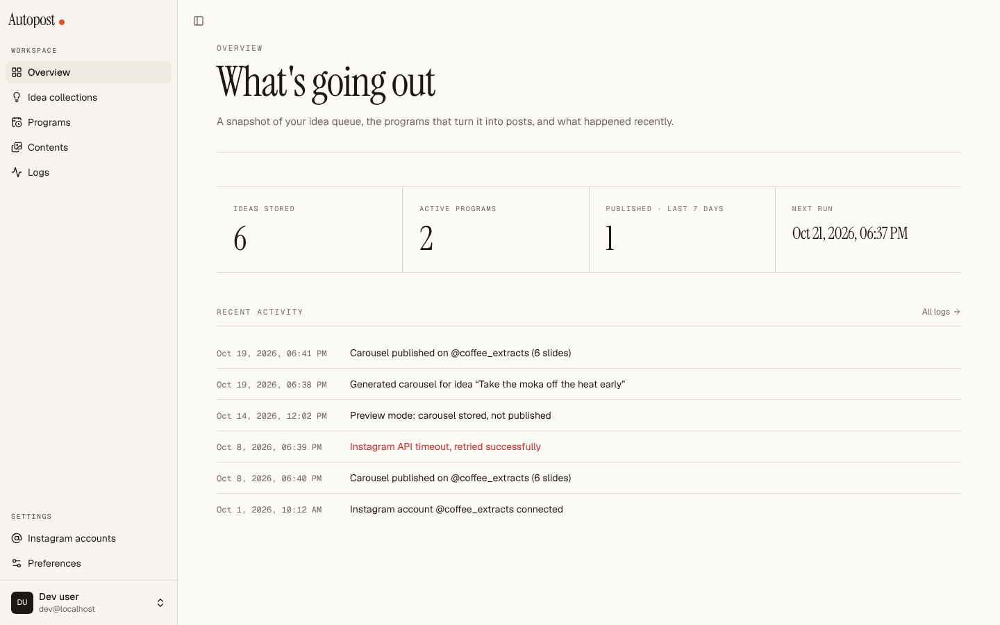
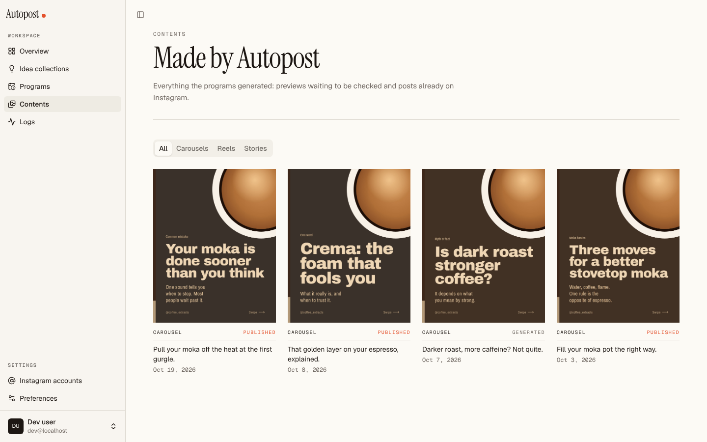
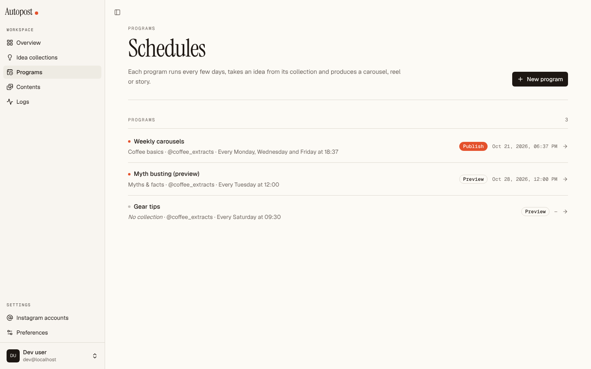

# Autopost · Frontend

**Web dashboard for Autopost, a tool that turns a list of ideas into Instagram posts on a schedule.**

You store content ideas in collections, create *programs* that pick the next idea on a cron schedule, and Autopost generates the carousel and publishes it to a connected Instagram account. This repository is the Next.js frontend; the API lives in [autopost_backend](https://github.com/WiktorVerga/autopost_backend).


<p align="center">
  
  
  
  
</p>

<sub>Screenshots taken with sample data (a coffee education page), with the backend mocked.</sub>

---

## Features

- **Sign in with Google.** OAuth is handled by the backend; the browser only ever sees a first-party session cookie.
- **Overview.** Ideas stored, active programs, posts published in the last 7 days, next scheduled run and the latest activity.
- **Idea collections.** Group ideas by theme, add, edit and delete them. Programs always pick the oldest idea they haven't published yet.
- **Programs.** Visual schedule picker (hourly, daily, weekly, monthly) that is translated to a standard cron expression, timezone, target Instagram account and two modes: `preview` (generate only) or `publish` (generate and post).
- **Contents.** Gallery of everything the programs generated, filterable by carousel, reel or story, with status (generated, published, failed).
- **Logs.** Per-program timeline of info, warnings and errors.
- **Instagram accounts.** Connect and disconnect accounts through the Instagram OAuth flow.
- **Preferences.** Light, dark or system theme.
- **Resilient UI.** Skeletons while data streams in, empty states, and a clear notice when the API is unreachable instead of a broken page.

## Tech stack

| Area | Choice |
|---|---|
| Framework | Next.js 16 (App Router, Cache Components, Partial Prefetching, Turbopack) |
| UI | React 19, TypeScript, Tailwind CSS v4, shadcn/ui (Radix), lucide-react |
| Feedback | sonner (toasts), next-themes (theme switching) |
| Fonts | Instrument Serif (self-hosted, OFL), Geist and Geist Mono |
| Backend | [autopost_backend](https://github.com/WiktorVerga/autopost_backend) (FastAPI) |

## How it talks to the backend

```
Browser ──/api/*──▶ Next.js (rewrite) ──▶ FastAPI (API_URL)
Server Components ──────────────────────▶ FastAPI, forwarding the user's cookies
```

- **Same origin.** The browser only calls `/api/*`; `next.config.ts` rewrites it to the backend, so the session cookie stays first-party and no CORS setup is needed.
- **Server reads, client writes.** Lists are fetched in Server Components; forms use a small browser client and then call `router.refresh()`.
- **Route protection.** `src/proxy.ts` (the Next 16 name for `middleware.ts`) redirects to `/login` when the session cookie is missing. It is an optimistic check: the backend validates the session on every request.
- **Single source of truth for routes.** Every backend path is declared once in `src/lib/api/endpoints.ts`; response shapes are in `src/lib/api/types.ts`.

| Method | Backend path | Used by |
|---|---|---|
| GET | `/auth/google/login` | "Continue with Google" (redirect) |
| GET · POST | `/auth/me` · `/auth/logout` | User menu, sign out |
| GET · POST · PATCH · DELETE | `/idea-collections` | Idea collections |
| GET · POST · PATCH · DELETE | `/ideas` | Ideas inside a collection |
| GET · POST · PATCH · DELETE | `/programs` | Programs |
| GET | `/contents` | Contents, Overview |
| GET | `/logs` | Logs, Overview, program detail |
| GET · DELETE | `/instagram-accounts` | Instagram accounts |
| GET | `/instagram-accounts/oauth/login` | "Connect Instagram" (redirect) |

## Getting started

**Requirements:** Node.js 20.9 or newer, and the [backend](https://github.com/WiktorVerga/autopost_backend) running locally if you want real data.

```bash
git clone https://github.com/WiktorVerga/autopost_frontend.git
cd autopost_frontend
npm install
cp .env.example .env.local     # on Windows: copy .env.example .env.local
npx next dev
```

Open <http://localhost:3000>.

> Tip: set `AUTH_BYPASS=true` in `.env.local` to browse the UI without signing in. Pages that need data show "The Autopost API is not reachable" until the backend is running on `API_URL`.

### Environment variables

| Variable | Default | Notes |
|---|---|---|
| `API_URL` | `http://localhost:8000` | FastAPI base URL. Server-side only. |
| `SESSION_COOKIE_NAME` | `autopost_session` | Name of the cookie set by the backend after login. Must match the backend's `AUTH_COOKIE_NAME`. |
| `AUTH_BYPASS` | `false` | `true` only in development, never in production. |

For Google sign-in to land the cookie on the frontend origin, register the Google redirect URI **through the frontend**: `http://localhost:3000/api/auth/google/callback` (and the production equivalent).

### Scripts

| Command | What it does |
|---|---|
| `npx next dev` | Development server with Turbopack |
| `npm run build` | Production build |
| `npm run start` | Serve the production build |
| `npm run lint` | ESLint |

## Project structure

```
src/
├─ app/
│  ├─ (auth)/login/        Sign-in page (public)
│  ├─ (app)/               Authenticated area with the sidebar
│  │  ├─ page.tsx          Overview
│  │  ├─ idea-collections/ Collections and their ideas
│  │  ├─ programs/         Programs, schedule picker, program detail
│  │  ├─ contents/         Generated contents
│  │  ├─ logs/             Activity log
│  │  ├─ account/          Instagram accounts
│  │  └─ settings/         Preferences (theme)
│  ├─ fonts/               Self-hosted Instrument Serif
│  └─ globals.css          Theme tokens (Tailwind v4 + shadcn)
├─ components/             shadcn/ui components, sidebar, page header, empty states
├─ hooks/
├─ lib/
│  ├─ api/                 Endpoints, types, browser and server clients, errors
│  ├─ auth.ts              getCurrentUser(), AUTH_BYPASS
│  ├─ cron.ts · schedule.ts  Schedule ⇄ cron translation
│  └─ format.ts            Date and label helpers
└─ proxy.ts                Auth redirect
```

## Design

"Paper and ink": warm off-white background, near-black ink and a single vermilion accent. Instrument Serif for titles, Geist for the interface, Geist Mono for metadata. Surfaces stay flat, with hairline rules and no shadows, and images sit directly on the page instead of inside raised cards.

## Roadmap

- Align the remaining endpoints (`/contents`, `/logs`) with the backend as its pipeline lands.
- Generate `types.ts` from the backend OpenAPI schema instead of maintaining it by hand.
- Reels and stories alongside carousels.

## Author

**Wiktor Verga** · [GitHub](https://github.com/WiktorVerga) · [LinkedIn](https://linkedin.com/in/wiktor-verga)
